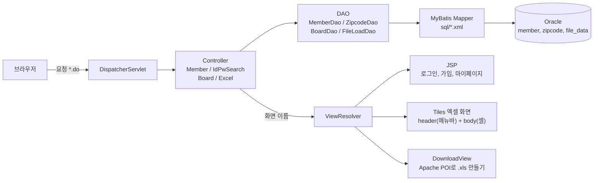
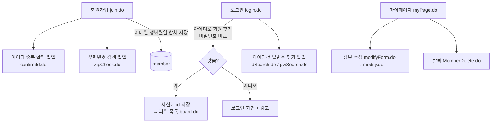

# Web Cell

웹 브라우저에서 엑셀 파일을 만들고 편집하는 **웹 엑셀 편집기**입니다.
KH정보교육원 교육 과정 중 진행한 파이널 프로젝트입니다.

| 항목 | 내용 |
|---|---|
| 기간 | 2016.06.01 ~ 2016.07.18 |
| 팀 | 5명 (팀명: 기가막히조) |
| 내 역할 | 회원 기능 전체, 엑셀 화면 메뉴바 |
| 기술 | Java, Spring 4.2 (Spring MVC), MyBatis 3.2, Apache Tiles 3, Apache POI 3.9, JSP, JSTL, jQuery |
| DB / 서버 | Oracle 11g, Tomcat 8.0 |
| 빌드 / 도구 | Gradle, Eclipse STS, eXERD, Git |

## 주요 기능

- 웹 화면에서 엑셀 시트 만들기와 편집
- 평균·합계·최소값 등 함수 쓰기
- 만든 시트를 엑셀 파일(.xls)로 내려받기
- 로그인한 사용자의 파일 목록 보기와 삭제
- 회원 기능: 가입, 로그인/로그아웃, 정보 보기·수정, 탈퇴, 아이디·비밀번호 찾기

## 구조

Spring의 `DispatcherServlet`이 모든 `*.do` 요청을 받아 `@RequestMapping`이 붙은 컨트롤러로 넘기는 **Spring MVC** 구조입니다.
DAO는 `SqlSessionDaoSupport`를 이어받아 MyBatis를 쓰고, 화면은 Tiles와 JSP로 만듭니다.



### 화면을 고르는 순서

`dispatcher-servlet.xml`에 화면을 찾는 방법이 세 가지 있고, 컨트롤러가 돌려준 이름에 따라 아래처럼 나뉩니다.

| 순서 | ViewResolver | 쓰이는 곳 |
|---|---|---|
| 1 | `TilesViewResolver` | `Tiles/excel_layout` → 메뉴바(`header.jsp`) + 셀 화면(`body.jsp`) |
| 2 | `BeanNameViewResolver` | `downView` → `DownloadView`(엑셀 파일 내려받기) |
| 3 | `InternalResourceViewResolver` | 그 밖의 이름 → `/WEB-INF/views/이름.jsp` |

### 회원 기능 흐름



## 내가 맡은 부분

| 기능 | 파일 |
|---|---|
| 로그인·로그아웃, 회원가입, 정보 보기·수정, 탈퇴 | `Final/Controller/MemberController.java` |
| 아이디·비밀번호 찾기 | `Final/Controller/IdPwSearchController.java` |
| 회원·우편번호 DB 처리 | `Final/Dao/MemberDao.java`, `ZipcodeDao.java`, `sql/memberMapper.xml`, `zipcodeMapper.xml` |
| 화면 | `views/loginPage/*`, `views/joinPage/*`, `views/Mypage/*`, `resources/join.js`, `zipcheck.js`, `delete.js` |
| 엑셀 화면 메뉴바 | `views/Tiles/header.jsp` |

- **로그인 유지:** 아이디로 회원을 찾아 비밀번호가 맞으면 세션에 아이디를 저장해, 파일 목록·마이페이지에서 로그인한 사용자를 알 수 있게 했습니다.
- **입력값 확인:** 화면(JavaScript)에서 빈칸, 비밀번호 일치, 이름은 한글만, 휴대폰 번호 형식을 확인하고, 아이디 중복 확인을 해야만 가입되게 했습니다. 같은 확인 코드(`join.js`)를 정보 수정 화면에서도 다시 썼습니다.
- **나눠 받은 값 합치기:** 이메일(아이디 + 도메인)과 생년월일(연·월·일)을 나눠 받아 서버에서 합쳐 저장하고, 수정 화면에서는 반대로 다시 나눠 채웠습니다.
- **우편번호 검색:** 팝업에서 검색해 고른 주소가 가입 화면에 자동으로 채워집니다.
- **메뉴바:** Tiles로 엑셀 화면을 위(메뉴바)와 아래(셀)로 나누고, 저장·다운로드·함수·정렬·추가 메뉴를 드롭다운으로 구성했습니다.

## 폴더 구조

```
├── src/main/java/Final/
│   ├── Controller/   요청을 받는 컨트롤러
│   ├── Dao/          MyBatis로 DB를 다루는 클래스
│   ├── Model/        회원·파일·우편번호 데이터 클래스
│   └── View/         엑셀 파일을 만드는 View (Apache POI)
├── src/main/resources/
│   ├── db.properties DB 접속 정보
│   └── sql/          MyBatis 매퍼(xml)
├── src/main/webapp/
│   ├── WEB-INF/      web.xml, dispatcher-servlet.xml, tilesdef, views(JSP)
│   └── resources/    JS, CSS, 이미지
├── libs/ojdbc6.jar   Oracle 드라이버
├── build.gradle
└── example.project / example.classpath / example.gitignore   이클립스 설정 참고용
```

## 실행 방법

1. Oracle에 `member`, `file_data`, `zipcode` 테이블을 만듭니다. (테이블을 만드는 SQL은 저장소에 없습니다. 매퍼 xml의 칼럼을 참고하세요.)
2. `src/main/resources/db.properties`에 DB 접속 정보를 넣습니다.
3. `build.gradle`로 의존성을 받은 뒤, Eclipse에서 웹 프로젝트로 가져와 Tomcat 8.0에서 실행합니다.

## 참고

- 마감 시점에 정리되지 않은 소스라 화면과 다른 부분이 있습니다.
  - 파일 목록에서 여는 `excel.do`와 수식 계산 `formula.do`를 받는 서버 코드가 없습니다.
  - 기존 엑셀 파일 불러오기(`existExcel.do`)는 개발자 PC의 파일 경로가 코드에 고정되어 있습니다.
  - 메뉴바는 저장, 불러오기, 함수 더보기 외에는 눌러도 동작하지 않고, 함수 메뉴에 '최대값'이 두 번 들어가 있습니다.
- 회원 탈퇴는 코드상 동작하지 않습니다.
  - 탈퇴 SQL이 `delete * from member ...`로 되어 있어 Oracle 문법 오류가 납니다. (`delete from member`가 맞음)
  - 컨트롤러가 미리 주입된 DAO 대신 메서드 인자로 새 `MemberDao`를 받아 써서 DB 연결이 없습니다.

## 돌아보며

지금 다시 만든다면 이렇게 바꾸고 싶습니다.

- 비밀번호를 그대로 저장하지 않고 **해시(bcrypt 등)로 저장**하고, 비밀번호 찾기는 화면에 보여 주는 대신 **임시 비밀번호 발급이나 재설정** 방식으로 바꾸기
- 입력값 확인을 화면뿐 아니라 **서버에서도** 하기
- 탈퇴 SQL과 DAO 주입을 고치고, 탈퇴 후 세션도 끊기
- `fileMapper.xml`의 `${id}`처럼 값을 SQL에 그대로 붙이는 부분을 **`#{}`로 바꿔** SQL 인젝션 막기
- 컨트롤러에 모인 이메일·생년월일 합치기 코드를 따로 빼서 가입·수정에서 함께 쓰기
